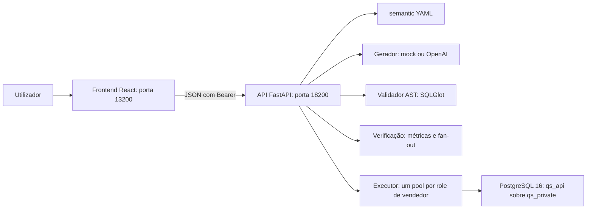
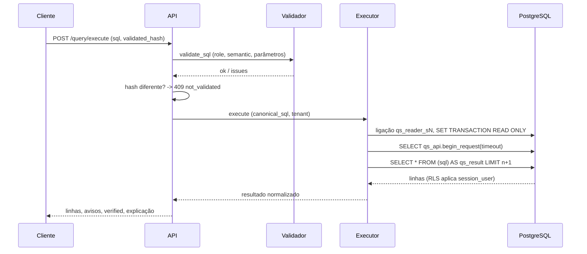

# Arquitectura

## Visão geral

## Camadas de defesa

Cada camada é independente e tem testes próprios. A ordem de execução de um pedido é a mesma
do pipeline de 7 passos (`docs/learn/00-visao-geral.md`).

| # | Camada | Ficheiros | Protege contra |
|---|---|---|---|
| 1 | Token assinado (issuer, audience, expiração, claims tipados) | `backend/app/auth/` | acesso sem identidade; tenant forjado |
| 2 | Semantic layer por papel | `semantic/`, `backend/app/semantic/` | o modelo ver colunas ou tabelas que não deve |
| 3 | Validador AST | `backend/app/validation/` | escrita, multi-statement, tabelas e funções não permitidas, produtos cartesianos |
| 4 | Verificação semântica | `backend/app/verification/` | respostas com a métrica errada ou fan-out (sem bloquear) |
| 5 | Executor com uma pool por role de vendedor | `backend/app/execution/` | escrita, timeout, excesso de linhas, erros com detalhes de infra |
| 6 | Base de dados | `db/migrations/` | sem privilégios de escrita; sem PII (vistas); RLS por `session_user` |

## Modelo de dados

- Tabelas de negócio em `qs_private` (dono `qs_app`, `FORCE ROW LEVEL SECURITY`).
- Vistas públicas em `qs_api` com colunas explícitas; `customers` sem email nem telefone;
  `internal_fraud_flags` sem vista.
- `qs_reader_s1..s3` têm `SELECT` só nas vistas, `default_transaction_read_only = on` e
  `search_path = qs_api`. A migração 006 associa cada role ao seu vendedor e a migração 007 faz a RLS
  derivar a visibilidade de `session_user`, mesmo através das vistas; a API exige um segredo distinto.

## Fluxo de um pedido de execução

## Componentes que não estão em produção

- **Gerador mock** (`backend/app/generation/mock.py`): regras determinísticas, marcadas `provider: mock`.
- **Experiência de laboratório** (`eval/ablation.py`): executa SQL de ataque sem validador; nunca
  exposta pela API.
- **Baseline insegura** (`eval/run_baseline.py`): só num sandbox descartável.
- **Login demo** (`POST /auth/demo-login`): desactivado por omissão.

## Persistência

Nada persiste além da base de dados. O registo de hashes validados, o histórico e os ficheiros de
avaliação são em memória (histórico e registo) ou em `eval/` (relatórios e golden). Reiniciar a API
apaga o histórico; é uma limitação conhecida, não um requisito desta fase.
