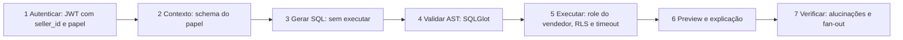

# 00 — Visão geral do QueryShield

## O problema

"Pergunta aos teus dados em linguagem natural" parece uma demo simples: o modelo escreve SQL, a base de dados responde. Na prática há quatro riscos que a demo esconde:

1. **Escrita e destruição.** O SQL gerado pode ser `DROP TABLE` ou `UPDATE`.
2. **Dados que não devia ver.** Emails e telefones de clientes, ou tabelas internas como `internal_fraud_flags`.
3. **Outro tenant.** Num marketplace multi-vendedor, um vendedor não pode ver as encomendas de outro.
4. **Resposta errada com SQL válido.** "Receita" sem excluir devoluções, ou um `SUM` inflacionado por um join (fan-out). O SQL corre sem erro e o número está errado.

O QueryShield trata cada risco numa camada diferente. Nenhuma camada substitui outra.

## O que entra e o que sai

Entra: uma pergunta em português e um token de um vendedor com papel. Sai: o SQL proposto, a justificação, os avisos, e (se tudo passar) as linhas do tenant autenticado.

Saída real do estado actual do projecto (`GET /schema/semantic`, papel `seller_analyst`, obtida com `uvicorn` e `curl`):

```
no-token status: 401
role seller_analyst tables ['sellers', 'categories', 'customers', 'products', 'orders', 'order_items', 'returns']
customers cols ['id', 'seller_id', 'full_name', 'city', 'created_on']
metrics ['periodo', 'venda', 'encomenda_valida', 'receita', 'devolucao']
joins 11
health: 200
{"error":{"code":"unauthenticated","message":"Persona desconhecida."}}
```

## Como funciona por dentro

Pipeline de 7 passos, pela ordem definida em `openspec/changes/bootstrap-queryshield/proposal.md`:



Estado por passo (2026-11-24):

| Passo | Estado | Onde está |
|---|---|---|
| 1 Autenticar | feito | `backend/app/auth/tokens.py`, `backend/app/auth/dependencies.py` |
| 2 Contexto por papel | feito | `backend/app/semantic/view.py`, `semantic/schema.yaml` |
| 3 Gerar SQL | implementado | `backend/app/generation/`, `backend/app/api/routes_query.py` |
| 4 Validar AST | implementado | `backend/app/validation/`, `POST /query/validate` |
| 5 Executar | implementado; uma pool por role de vendedor | `backend/app/execution/`, migrações `006` e `007` |
| 6 Preview | implementado | `backend/app/api/routes_query.py`, frontend React |
| 7 Verificar | implementado | `backend/app/verification/` |

Cada passo tem cobertura associada em `tests/`. A validação PostgreSQL/RLS depende de executar a suite marcada `postgres`; a avaliação real com um LLM continua por medir.

## Porquê esta escolha

- **Camadas independentes.** A autenticação decide o tenant e o papel. O schema limita o que o modelo *vê*. O AST limita o que o SQL *pode dizer*. A base de dados limita o que a ligação *pode fazer*. Um erro numa camada não é uma fuga, porque as outras continuam activas.
- **Execução só depois de validação.** O passo 3 nunca executa. A execução exige uma validação do mesmo SQL (ver `POST /query/execute`, tarefa 4.3).
- **Sem Docker.** O PostgreSQL real vem do pacote `pgserver`. Isto é necessário porque RLS, roles e `statement_timeout` não têm equivalente fiel em SQLite.

## Alternativas

- **Só prompt com regras** ("nunca uses DROP"). Não é uma garantia: o modelo pode ser manipulado por injecção (ver `specs/sql-generation`).
- **Só validador de regex**. Falha com comentários, maiúsculas e strings (ver doc 03).
- **Só base de dados**. Protege contra escrita e fuga de dados, mas não detecta resposta errada com SQL válido nem fan-out.

## Como falha

- Token ausente, malformado, expirado ou com claims forjados: 401 genérico (`tests/unit/test_semantic_and_auth.py`).
- Pedido sem autenticação a `/schema/semantic`: 401 (teste `test_semantic_endpoint_without_token_is_401`).
- A semantic layer não coincide com as vistas da base: falha `test_semantic_tables_and_columns_match_reader_views`.

## Perguntas de entrevista

**1. Porque é que o modelo não deve decidir o tenant?**
Porque o tenant é uma decisão de autorização. O servidor deriva o `seller_id` do token assinado e define-o na base de dados. Se o modelo pudesse escolher, qualquer instrução na pergunta ("mostra o vendedor 2") mudaria o isolamento.

**2. Qual é a diferença entre autenticação e autorização neste projecto?**
Autenticação: o token é válido e assinado. Autorização: o papel decide quais tabelas e colunas existem no contexto (`semantic/schema.yaml`) e a base de dados decide o que pode ser lido (grants e RLS).

**3. Porque é que há 4 camadas e não uma?**
Cada camada falha de forma diferente. O validador AST falha com parsers diferentes do PostgreSQL. A RLS falha se alguém criar uma tabela sem política. Só a combinação dá uma garantia que se possa defender.

**4. O que é a "resposta errada com SQL válido" e como se detecta?**
É o caso em que o SQL corre mas responde à pergunta errada. Detecta-se pela verificação contra a semantic layer (`metric_definition_mismatch`) e pela detecção de fan-out (`possible_fanout`), tarefa 5.1, e medida pela execution accuracy (tarefa 7.2).
